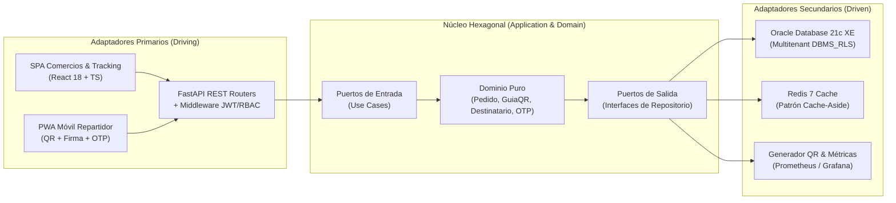

# LogistiX (DropFlow) — Plataforma SaaS Multitenant de Gestión de Despachos y Tracking de Última Milla

Plataforma logística **SaaS Multitenant** diseñada bajo **Arquitectura Hexagonal (Puertos y Adaptadores)** para digitalizar el registro de pedidos de despacho de PyMEs, emitir guías digitales con **código QR único**, validar entregas en campo desde una **PWA móvil** mediante **firma digital táctil u OTP**, y ofrecer **tracking público en tiempo real (`< 50 ms`)** respaldado por **Oracle Database 21c XE** y **Redis Cache-Aside**.

> **Contexto Académico:** Ingeniería de Software III (`FI303290`) — Programa de Ingeniería de Sistemas, Institución Universitaria Antonio José Camacho (UNIAJC) — Período `2026-2`.  
> **Docente:** Ing. José Lizardo Castro Guaraca.

---

## 1. Equipo Scrum y Roles (`Proyecto Jira: SCRUM`)

| Integrante | Rol Scrum | Responsabilidades Principales |
| :--- | :--- | :--- |
| **Bryner David Zúñiga Valencia** | **Product Owner** | Define la visión del producto, prioriza el Product Backlog en Jira, redacta criterios de aceptación en Gherkin (BDD) y valida los incrementos en cada Sprint Review. |
| **Karen Yiscell Muelas Aranda** | **Scrum Master** | Facilita las ceremonias Scrum, elimina impedimentos técnicos, gestiona el flujo del tablero en Jira y asegura el cumplimiento de la *Definition of Done (DoD)*. |
| **David Fernando Castro López** | **Developer Full Stack** | Implementa la Arquitectura Hexagonal (`FastAPI`), la SPA/PWA (`React 18 + TS`), el aislamiento multitenant en `Oracle 21c XE`, el caché `Redis`, pipelines CI/CD y pruebas. |

---

## 2. Arquitectura Hexagonal (`SCRUM-116` / `SCRUM-120`)

El backend desacopla estrictamente la lógica de negocio respecto de los frameworks y motores de persistencia mediante tres anillos concéntricos:



### Estructura del Repositorio

```text
LogistiX/
├── .github/workflows/       # Pipelines CI/CD en GitHub Actions (lint, pytest, SAST)
├── backend/
│   ├── domain/              # Reglas de negocio puras (sin dependencias externas)
│   │   ├── entities/        # Entidades (Pedido, Destinatario, GuiaDespacho)
│   │   ├── value_objects/   # Objetos de valor (TrackingCode, CodigoOTP, Direccion)
│   │   └── exceptions/      # Excepciones de dominio
│   ├── ports/               # Contratos explícitos del núcleo
│   │   ├── input/           # Casos de uso (CrearPedidoUseCase, ValidarEntregaUseCase)
│   │   └── output/          # Interfaces de persistencia, caché y servicios externos
│   ├── adapters/            # Implementaciones técnicas de infraestructura
│   │   ├── api/             # Controladores REST FastAPI, esquemas Pydantic v2 y JWT
│   │   ├── persistence/     # Repositorios SQLAlchemy / oracledb con Tenant-Isolation
│   │   ├── cache/           # Cliente asíncrono Redis (Cache-Aside, TTL 300s)
│   │   └── qr/              # Generación de etiquetas y códigos QR dinámicos
│   └── tests/               # Pruebas unitarias (unit/), integración y BDD (bdd/features/)
├── frontend/
│   ├── public/              # Manifiesto PWA (manifest.json) y Service Workers
│   └── src/                 # Componentes, páginas, hooks, servicios API y tipos TS
├── database/                # Migraciones Alembic, DDL Multitenant y planes EXPLAIN PLAN
├── scripts/                 # Scripts de carga con K6 (k6/) y utilidades de despliegue
└── docs/                    # Diagramas C4 (architecture/) y decisiones técnicas (adr/)
```

---

## 3. Stack Tecnológico

| Capa | Tecnología | Uso en LogistiX |
| :--- | :--- | :--- |
| **Backend API** | `Python 3.11` + `FastAPI` + `Pydantic v2` | API REST asíncrona bajo Arquitectura Hexagonal y documentación OpenAPI. |
| **Base de Datos** | `Oracle Database 21c XE` | Persistencia relacional multitenant con políticas `DBMS_RLS` e índices auditados con `EXPLAIN PLAN`. |
| **Caché** | `Redis 7` (`redis-py` async) | Patrón *Cache-Aside* para consultas públicas de tracking en `< 50 ms` y almacenamiento de códigos OTP. |
| **Frontend & PWA** | `React 18` + `TypeScript` + `Vite` + `Tailwind CSS` | Dashboard comercial, portal público de tracking y PWA móvil con escáner QR (`html5-qrcode`) y firma táctil (`signature_pad`). |
| **Calidad y Pruebas** | `Pytest` + `pytest-bdd` (Gherkin) + `K6` | Cobertura unitaria `>= 75%`, pruebas de aceptación BDD y pruebas de estrés (`150–300 VUs`, `p95 < 500 ms`). |
| **DevOps & Monitoreo** | `Docker Compose` + `GitHub Actions` + `Prometheus/Grafana` | Contenerización homologada, integración continua y observabilidad de métricas RED. |

---

## 4. Épicas y Planificación Scrum en Jira (`92 Story Points`)

| Épica | Ticket Jira | Alcance Funcional y Técnico | Historias Vinculadas | Sprint |
| :--- | :--- | :--- | :--- | :--- |
| **EP-01** | `SCRUM-111` | Arquitectura Base, Setup y CI/CD | `US-01`, `US-02`, `US-03` (`11 SP`) | **Sprint 0** |
| **EP-02** | `SCRUM-112` | Gestión de Pedidos, Guías QR y Despachos | `US-04`, `US-05`, `US-06` (`21 SP`) | **Sprint 1** |
| **EP-03** | `SCRUM-113` | Persistencia Multitenant (`Oracle 21c`) y `Redis` | `US-07`, `US-08`, `US-09` (`18 SP`) | **Sprint 1** |
| **EP-04** | `SCRUM-114` | Módulo Móvil Repartidor y Tracking Público | `US-10`, `US-11`, `US-14` (`21 SP`) | **Sprint 2** |
| **EP-05** | `SCRUM-115` | Seguridad JWT, BDD y Go-Live | `US-12`, `US-13`, `US-15` (`21 SP`) | **Sprint 2** |

---

## 5. Acuerdos de Código, GitFlow y Definition of Done (DoD)

### Flujo de Ramas (GitFlow) y Convención de Commits
- **`main`**: Rama estable de producción (protegida).
- **`develop`**: Rama de integración continua de cada Sprint.
- **`feature/SCRUM-XXX-<descripcion>`**: Ramas de trabajo vinculadas al ticket de Jira correspondiente.
- **Formato de Commits**: *Conventional Commits* referenciando el ticket de Jira:
  ```bash
  feat(SCRUM-131): implement CrearPedidoUseCase and Pydantic schemas
  fix(SCRUM-152): invalidate Redis tracking key on order status update
  docs(SCRUM-120): document hexagonal architecture and code agreements
  ```

### Checklist Definition of Done (DoD)
- [ ] La capa `backend/domain/` no importa librerías de infraestructura (`FastAPI`, `SQLAlchemy`, `redis`).
- [ ] El linter (`Ruff` en Python / `ESLint` en TypeScript) ejecuta con **0 errores**.
- [ ] Cobertura de pruebas unitarias en `Pytest >= 75%` y escenarios BDD Gherkin (`.feature`) en verde.
- [ ] Aislamiento multitenant verificado (`tenant_id` inyectado y validado en sesión de base de datos).
- [ ] Pull Request aprobado mediante *Code Review* y validado por el *Product Owner*.
